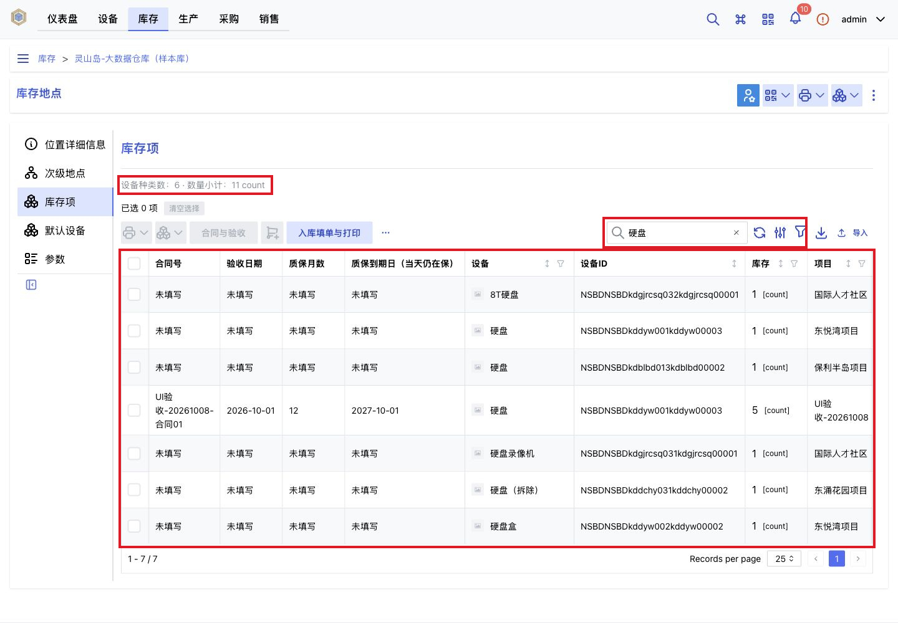
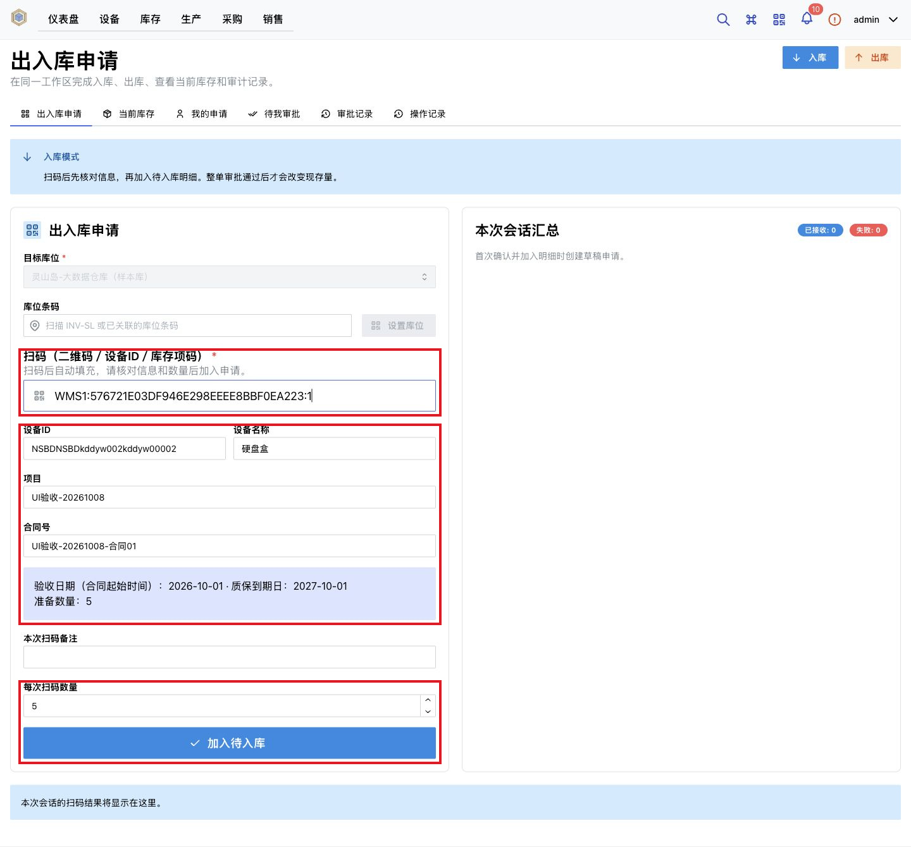
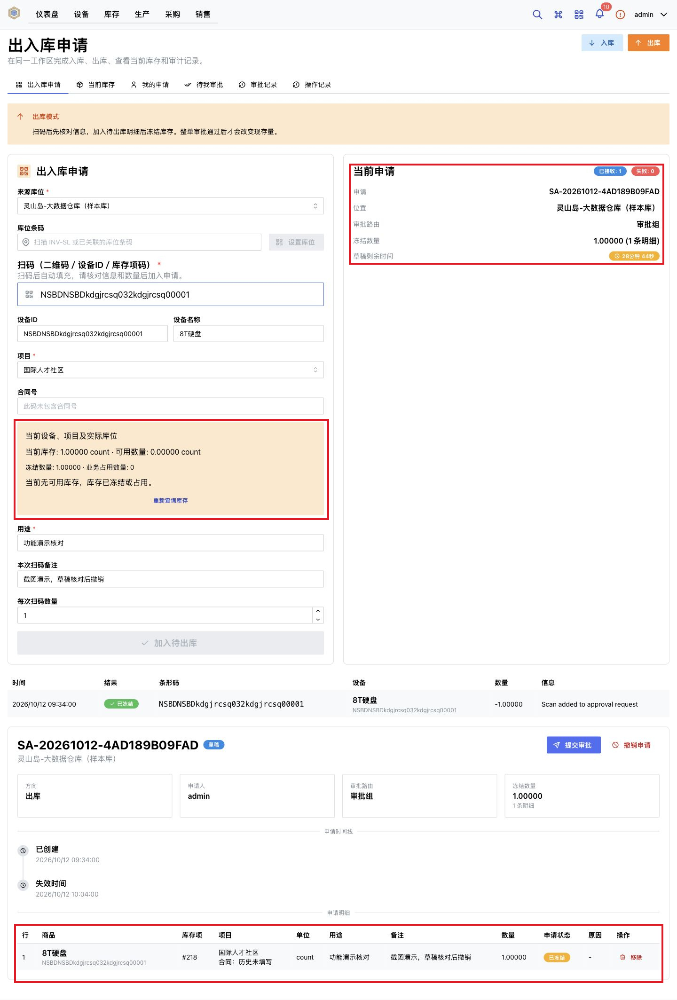
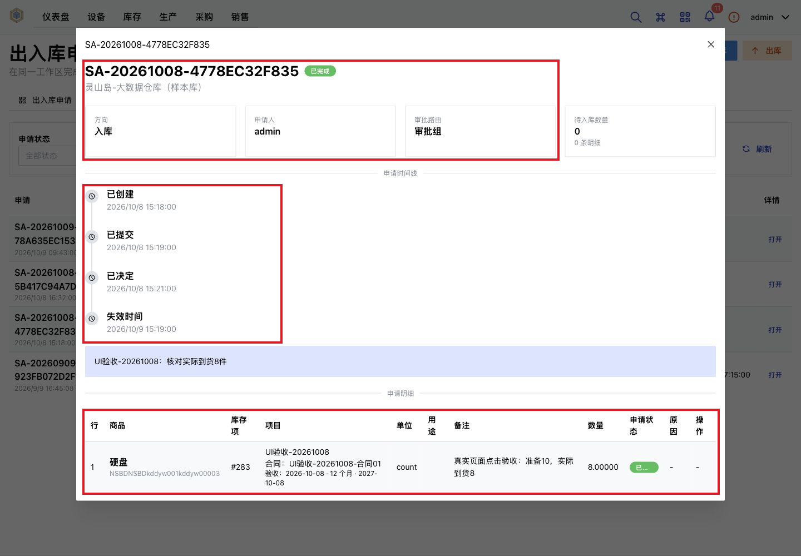
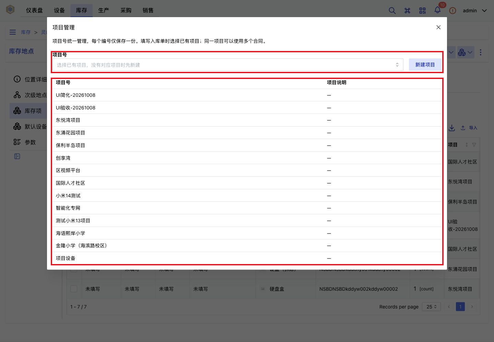
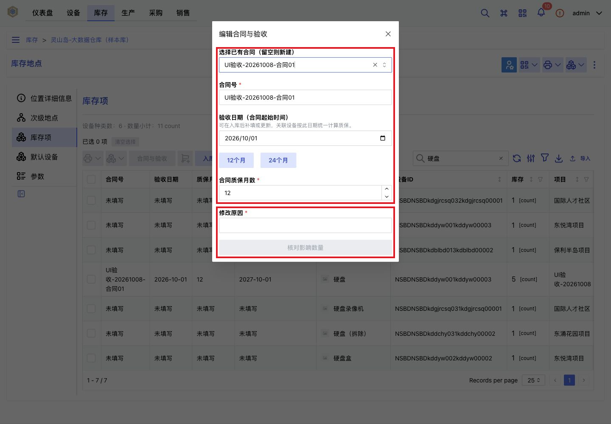
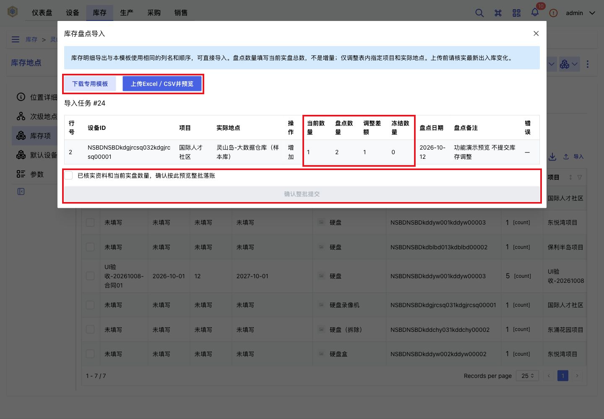
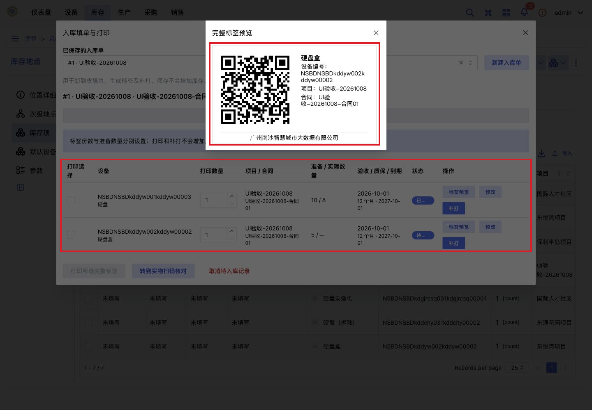
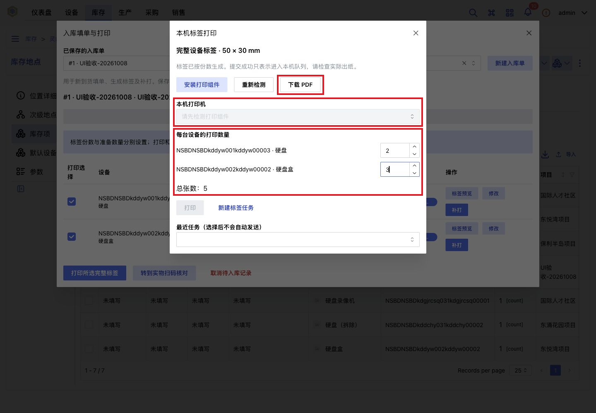

# wmsYe · 成品仓 WMS

基于 **InvenTree 1.5.1** 二次开发的中文仓库管理系统，面向设备和成品的日常收发、项目库存、合同质保及标签打印。将扫码核对、整单审批、库存冻结、盘点导入和操作追溯接入同一套库存账。

[功能说明](#功能说明) · [主要功能截图](#主要功能截图) · [业务流程](#业务流程) · [首次运行](#首次运行) · [完整功能图集](docs/FEATURES.md)

## 项目定位

适用于需要按项目和实际库位管理设备、核对收发数量、跟踪合同质保的仓库。通过浏览器使用，扫码枪以键盘输入方式接入，也可手动输入设备码。

| 使用角色 | 日常工作 |
| --- | --- |
| 仓库操作员 | 扫码核对、填写数量与用途、提交入出库申请、查看库存和自己的申请 |
| 审批人员 | 按库位审批路由处理申请，核对整单明细，查看审批记录 |
| 管理人员 | 维护设备、库位、项目及合同，进行盘点、数据导出、权限配置与审计查询 |

仓库提供应用源码、容器部署配置、中文操作文档和功能截图，可从普通 Git clone 开始构建。原生 InvenTree 提供设备、库存、地点、权限和流水基础；本项目在这些能力上增加仓库业务规则与中文操作页面。

## 功能说明

### 基础库存功能

以下 9 项是日常仓库作业能力，包含复用的原生功能和本项目的业务增强。点击编号可查看对应完整页面及说明。

| 编号 | 功能 | 主要说明 |
| --- | --- | --- |
| [B01](docs/FEATURES.md#b01) | 设备资料管理 | 维护设备编码、名称、分类、单位、品牌、型号、规格与备注，支持新建、编辑和停用 |
| [B02](docs/FEATURES.md#b02) | 仓库与库位管理 | 管理多层级地点，明确实际存货位置，区分本地点直属库存与包含下级地点的库存 |
| [B03](docs/FEATURES.md#b03) | 入库管理 | 记录设备、实际数量、项目、目标库位和经办人员；启用审批时，通过后才增加库存 |
| [B04](docs/FEATURES.md#b04) | 出库管理 | 按指定项目和实际库位核对可用库存，记录出库数量、用途、备注与经办人员 |
| [B05](docs/FEATURES.md#b05) | 库存查询 | 查看库存明细与设备汇总，区分实物量、冻结量和可用量，支持关键字及业务条件筛选 |
| [B06](docs/FEATURES.md#b06) | 库存盘点 | 上传 Excel / CSV 实盘数据，预览系统数量、实盘数量和调整差额，核对后整批提交 |
| [B07](docs/FEATURES.md#b07) | 出入库记录 | 独立“统计查询”页面按项目、合同、设备名称／型号、日期和库位查询已落账记录，分单位汇总并导出，支持查看与补充单据附件 |
| [B08](docs/FEATURES.md#b08) | 数据导入导出 | 支持设备资料导入、库存初始化、盘点导入，以及库存明细、设备汇总和出入库记录导出 |
| [B09](docs/FEATURES.md#b09) | 权限与追溯 | 按用户及角色控制查看、操作和审批权限，保留人员操作记录与原生库存流水 |

### 主要二次开发功能

| 编号 | 功能 | 二开内容 |
| --- | --- | --- |
| [D01](docs/FEATURES.md#d01) | 扫码作业 | 统一识别设备编号、库存项码和完整标签；完整标签自动带出设备、品牌、规格、型号、单位、项目、合同和数量，进入作业页自动聚焦扫码框，完整标签回车加入待办；支持按名称／型号选择来源明细，重复回车与网络重试不重复记账 |
| [D02](docs/FEATURES.md#d02) | 项目库存管理 | 建立统一项目档案，按设备、项目和实际库位区分库存；项目可关联多张合同，出库不混扣其他项目 |
| [D03](docs/FEATURES.md#d03) | 整单审批 | 多条明细统一提交，支持通过、驳回、撤销和超时；按库位负责人路由，禁止自审，整单校验后统一落账 |
| [D04](docs/FEATURES.md#d04) | 出库冻结 | 出库明细加入草稿即冻结可用数量，通过后扣减实物库存；驳回、撤销、超时或移除明细后释放对应冻结 |
| [D05](docs/FEATURES.md#d05) | 库存页面增强 | 在原生库存表增加项目、合同、质保等业务字段与筛选，支持设备汇总、分单位统计及全部匹配结果导出 |
| [D06](docs/FEATURES.md#d06) | 批量导入校验 | 上传后先预览，逐行校验数量及匹配关系；错误整批拦截，防止重复执行和用过期预览覆盖已变化的库存 |
| [D07](docs/FEATURES.md#d07) | 合同与质保管理 | 在合同中统一维护验收日期和质保月数，关联设备统一计算到期日；修改时核对影响数量并填写原因 |
| [D08](docs/FEATURES.md#d08) | 入库填单与完整标签 | 提前准备入库明细与二维码标签，扫码读取设备、项目和合同，核对实际到货数量后办理入库 |
| [D09](docs/FEATURES.md#d09) | 标签与本地打印 | 支持标签预览、逐条设置打印份数、补打、PDF 下载，以及可选的 Windows QZ Tray 本地队列打印 |
| [D10](docs/FEATURES.md#d10) | 安全与审计增强 | 防止重试导致重复入出库及并发超扣，保存申请、审批时间线、业务快照和库存变化前后数量 |

## 主要功能截图

以下图片复用 **2026-10-12 本机项目的真实完整前端截图**，红框标出对应功能。图片中的数据来自当时的预览实例，新部署不会自动包含这些记录。全部 **19 张截图**及逐项解释见[完整功能图集](docs/FEATURES.md)。

### 库存查询与业务字段

在原生库存页面查看设备、项目、合同和质保信息，搜索后同步显示设备种类与数量小计。支持[业务筛选](docs/FEATURES.md#d05)和[导入导出](docs/FEATURES.md#b08)。



### 扫码入库与信息核对

入库填单与日常作业统一使用原有扫码界面。完整标签扫码回车后自动带出资料并加入待入库／待出库；入库使用准备数量，出库使用所选实际库位的当前可用数量。出库用途选填并沿用本次填写的值，无法确定库位时提示选择。需要修改数量时可先输入标签、不按回车，修改后点击加入；入库数量与准备数量不同时仍须确认差异。审批通过后才改变实物库存。



### 出库申请与库存冻结

出库加入草稿后立即冻结本次数量。示例显示“实物 1、冻结 1、可用 0”，申请尚未正式出库；截图采集后已撤销演示草稿并释放冻结。未加入草稿前的[出库核对页面](docs/FEATURES.md#b04)可查看用途和备注填写方式。



### 整单审批与处理时间线

申请详情集中展示申请人、审批路由、处理时间线和所有设备明细。图中是已完成的入库申请，实际到货 8 件；顶部待入库数量为 0，表示该申请已处理完成。



### 项目档案与库存归属

在“库存工具 → 项目管理”统一建立项目号，入库时选择已有项目；同一个项目可在不同单据中使用不同合同。



### 合同验收与质保

验收日期作为合同起始时间，可在入库后补填。同一合同统一维护质保月数；修改前填写原因并核对关联设备数量，到期日当天仍在保。



### Excel / CSV 盘点预览

上传后先比较账面与实盘数量，核对后再整批提交。图中为系统数量 1、实盘数量 2、差额 +1 的预览；另有[错误整批拦截示例](docs/FEATURES.md#d06)，展示负数数量如何阻止提交。



### 入库填单与完整标签

提前保存设备、项目、合同和准备数量，生成标签供到货扫码。标签文字统一显示设备名称、品牌、规格、型号和公司名称，项目与合同通过二维码读取。准备数量、实际申请数量与标签份数分别管理，保存、打印和补打均不增加库存。



### 独立打印份数与 PDF 下载

每条设备单独设置份数，示例中两条设备分别为 2 张和 3 张，共 5 张。可下载 PDF；连接打印组件后可选择本机队列。截图时未连接打印组件，Windows 实物出纸及打印后扫码仍待现场验收。

库存项工具栏同样支持逐条设置份数。有关联来源明细的库存沿用入库标签的同一个完整二维码，扫描后读取设备、项目和合同；未关联的历史库存打印基础设备码。打印窗口显示项目、合同和标签类型供核对，两类库存可混合打印。



更多页面：[设备资料](docs/FEATURES.md#b01) · [仓库与库位](docs/FEATURES.md#b02) · [出入库记录](docs/FEATURES.md#b07) · [角色权限](docs/FEATURES.md#b09) · [操作审计](docs/FEATURES.md#d10)。

## 业务流程

### 入库

1. 管理人员建立设备、项目、合同与目标库位；需要完整标签时先在“入库填单与打印”准备明细。
2. 操作员扫描完整标签并回车，自动填充设备、项目、合同、目标库位及准备数量，加入待入库；信息不全时补填后加入。
3. 核对待入库明细，汇总成一张申请并提交。
4. 独立审批人核对整单；审批通过后增加库存并记录流水，驳回、撤销或超时不增加库存。

### 出库

1. 可选填写本次出库用途，扫描完整标签并回车，自动带出项目、合同与实际可用数量；只有一个有可用库存的库位时自动选择，多个库位时需明确选择。
2. 信息齐全时自动加入待出库并冻结对应数量，实物库存尚未扣减；重复回车和网络重试不会重复记账。
3. 提交整单审批，通过后统一扣减库存并释放冻结；驳回、撤销或超时释放冻结。

### 查询、盘点与追溯

1. 按设备、项目和实际地点查询库存，选择直属库存或包含下级地点的范围。
2. 下载专用模板，或导出库存明细，填写当前实盘总数；涉及来源明细时保留“明细标识”。
3. 上传文件并预览差异，处理错误后核对整批提交；资料或库存已变化时重新预览。
4. 在期间记录、审批记录、扫码记录和库存流水中查询人员、时间、原因与变动前后数量。

### 关键数量规则

原生库存历史与库存流水仅供拥有库存查看权限的审批员及管理员访问，操作员不可见，直接访问对应接口也会被拒绝。库存历史位于设备详情的“库存历史”页签，需要开启系统 `STOCKTAKE_ENABLE` 和个人 `DISPLAY_STOCKTAKE_TAB`；快照从启用后积累，按设备汇总实物库存（含变体），不扣除出库冻结，也不按项目或合同拆分。库存流水位于库存项详情，或“统计查询 → 库存流水”；关联成功扫码的流水使用落账时的项目、合同、库位、单位和人员快照，分别展示申请人、审批人及落账操作人。

| 概念 | 业务含义 |
| --- | --- |
| 实物库存 | 当前账面持有的数量，复用 InvenTree 原生库存余额 |
| 冻结数量 | 已被出库草稿或待审批申请占用、尚未正式扣减的数量 |
| 可用库存 | 实物库存减去原生业务占用，再减去扫码审批冻结；不同单位分别统计 |
| 盘点数量 | 调整后的实盘总数，例如账面 10、表中填 8，提交后为 8，而不是增加 8 |
| 标签份数 | 需要打印的标签张数，与准备数量和实际申请数量相互独立 |

上述入出库流程以开启审批为例；审批关闭时，符合条件的扫码按配置直接办理。完整操作规则见[合同、质保及完整标签使用说明](docs/INVENTREE_WMS_CONTRACT_WARRANTY_GUIDE.md)。

## 作业与统计查询优化（2026-11-04）

扫码作业保留原有 WMS 控件风格，删除重复的申请摘要卡片；待入库／待出库明细统一提供数量核对、移除、提交与撤销。进入或切换入出库后聚焦设备扫码框，处理完成后恢复扫码；编辑其他输入项或打开弹窗时不强制抢焦点。草稿加入明细后自动保存，一张申请仍只绑定一个方向和一个实际库位。

“按名称／型号添加”选择已有入库准备明细，保留原项目、合同和标签来源，随后核对数量并走同一审批流程。没有准备明细时可打开原入库填单入口建立明细；补打标签本身不增加库存。当前版本保留同一标签再次主动扫码入库的能力；重复回车、重复客户端事件和网络重试不等于一次新的主动扫码。

“统计查询”将入库记录、出库记录与权限控制的库存流水集中到独立页面。收发记录仅统计成功落账的扫码业务，日期按中国时区正式落账时间计算，结束日期包含全天；待审批、驳回、撤销及盘点调整不计入。不同单位分别汇总，导出与已应用的筛选条件一致。型号和品牌展示当前基础资料值，项目、合同、人员、时间沿用业务快照；不将期间收发差额当作当前库存。

到货单／出库单附件是可选的业务凭证，可在审批前或落账后补充，不改变审批结果或库存。支持 PDF、PNG、JPG，单文件不超过 10 MB；附件按审批单关联到明细，通过认证接口下载，记录上传人、时间和说明。原申请人或有相应权限的管理人员可以补充，其他人的访问遵循申请单可见范围。历史直接落账且没有审批单的记录保留查询，不自动伪造申请归属。

合同增加项目归属。历史合同只有明确关联一个项目时才自动回填；跨项目或缺失归属的旧合同保留待核对，不自动合并或改写库存。厂家继续使用现有品牌字段；本次不改打印流程。

## 当前功能边界

| 项目 | 当前状态 |
| --- | --- |
| 扫码方式 | 支持扫码枪 HID 键盘输入及手动输入；摄像头入口暂时停用 |
| 审批方式 | 按库位负责人处理整单，禁止自审；不包含多级会签或按金额动态审批 |
| 库存范围 | 按指定项目、来源明细和实际库位办理，不自动借用其他项目或库位的库存 |
| 记录与报表 | 提供当前库存与期间出入库记录，不提供任意历史时点余额或期初期末报表 |
| 项目与合同 | 服务于库存归属、验收和质保，不包含项目预算、进度或财务结算 |
| 标签打印 | PDF 与本地打印软件流程已有实现；Windows 驱动、实物出纸和扫码枪验收待完成，入队成功不等于已出纸 |
| 外部系统与离线 | 未提供正式 ERP / MES / 财务同步，也不支持离线排队后自动补传 |

## 架构与目录

浏览器中的 React / TypeScript 工作台通过 Django REST API 访问业务服务；PostgreSQL 17 保存库存和审批数据，Redis 7 提供缓存，Django-Q2 worker 处理异步任务，Caddy 提供 HTTPS 和静态资源。

```text
wmsYe/
├── InvenTree/          # Django 后端、React 前端、数据库迁移与测试
├── inventree-deploy/   # Compose、Caddy、环境变量模板与运维手册
└── docs/               # 功能图集、截图资源、操作指南与验收记录
```

`InvenTree/` 是本仓库中的普通源码目录，不需要初始化子模块。数据库、上传文件、真实环境变量、私钥、备份、依赖目录和本地验收日志不进入版本控制。

## 首次运行

需要 Git、Docker Engine / Docker Desktop（含 Compose v2）、Node.js 24 和 Corepack。先在本机配置能访问目标仓库的 SSH key。

```bash
git clone git@github.com:junfengye02-spec/wmsYe.git
cd wmsYe
cp inventree-deploy/.env.example inventree-deploy/.env
```

编辑 `.env`：填写数据库密码，把站点地址改成部署机可访问的域名或局域网 IP；保留 `INVENTREE_IMAGE=wmsye-inventree:dev`，以运行本仓库构建的二开镜像。

```bash
# 从源码构建前端和应用镜像
bash InvenTree/contrib/container/build-wms.sh

cd inventree-deploy
mkdir -p inventree-data
chmod 600 .env
docker compose config --quiet
docker compose up -d inventree-db inventree-cache

# 仅用于首次创建空数据库；已有环境升级请看部署手册
docker compose run --rm inventree-server invoke update --skip-backup
docker compose run --rm inventree-server invoke superuser
docker compose up -d
docker compose ps
```

管理员账号在上述交互命令中自行创建，不提供默认密码。浏览器访问 `.env` 中的 `INVENTREE_SITE_URL`。Caddy 默认使用内部 CA，首次访问须按[部署手册](inventree-deploy/README.md)安装可信根证书。登录后建立库位、商品、项目、合同，并配置业务用户权限和库位审批负责人。

## 开发与验证

```bash
cd InvenTree/src/frontend
corepack yarn install --frozen-lockfile
node --experimental-transform-types --test tests/unit/*.test.ts
corepack yarn compile
corepack yarn build
```

后端库存、审批、合同、项目和打印测试应运行在独立测试数据库；命令与隔离要求见[开发说明](docs/DEVELOPMENT.md)。端到端测试会创建数据，需单独准备测试环境。

## 文档

- [功能说明与 19 张完整页面截图](docs/FEATURES.md)
- [部署、升级、备份与环境变量](inventree-deploy/README.md)
- [开发结构与测试命令](docs/DEVELOPMENT.md)
- [首次导入验证记录](docs/INITIAL_IMPORT_VERIFICATION.md) / [变更记录](CHANGELOG.md)
- [合同、质保及完整标签使用说明](docs/INVENTREE_WMS_CONTRACT_WARRANTY_GUIDE.md)
- [Windows 本地打印配置](inventree-deploy/WINDOWS_LOCAL_PRINT.md)
- [Windows 实机验收交接](docs/WINDOWS_LOCAL_PRINT_READY_FOR_WINDOWS.md)
- [基础库存需求](docs/INVENTREE_WMS_INVENTORY_REQUIREMENTS.md)
- [二次开发功能清单（历史盘点）](docs/INVENTREE_WMS_SECONDARY_DEVELOPMENT_FEATURE_LIST.md)
- [库存历史验收](docs/INVENTREE_WMS_INVENTORY_ACCEPTANCE.md) / [合同质保历史验收](docs/INVENTREE_WMS_CONTRACT_WARRANTY_ACCEPTANCE.md)

方案与验收文档保留各阶段背景，旧地址、数量及运行状态不代表新部署结果；以当前源码和本 README 的启动流程为准。本页及功能图集使用的截图已存入 `docs/assets/screenshots/`，可在 GitHub 直接浏览；历史文档引用的其他本地日志、截图和运行数据不一定随仓库提供。

## 上游与许可

源码基于 InvenTree **1.5.1**，上游基线 commit 为 `84052e1ac8087c2ede499d72310c67e74dad3017`。二开镜像的上游底座 digest 固定在 `InvenTree/contrib/container/Dockerfile.wms`。

保留 InvenTree Developers 的版权声明及 [MIT 许可证](InvenTree/LICENSE)。本项目为独立二次开发版本；第三方依赖遵循其各自许可证，前端依赖及版本见 [package.json](InvenTree/src/frontend/package.json)。
